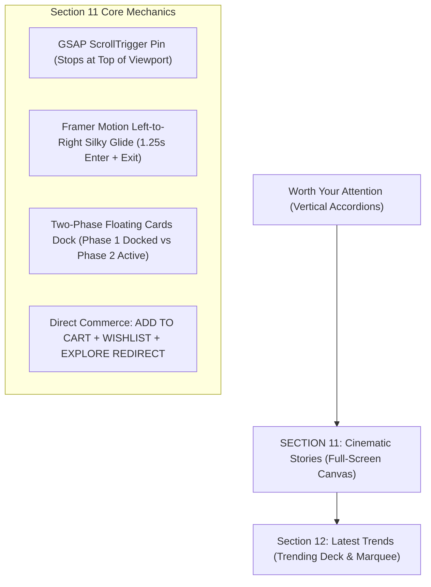

# Cinematic Stories ("Moments in Silk") — Architecture & Backend Developer Guide

> **Section Classification**: Section 11 (Immediate successor to *Worth Your Attention*)  
> **Source Component**: [`src/components/home/CinematicStories.tsx`](file:///Users/anuragkanaujiya/Desktop/Projects/monarch/src/components/home/CinematicStories.tsx)  
> **Dock Component**: [`src/components/home/StoryFloatingCard.tsx`](file:///Users/anuragkanaujiya/Desktop/Projects/monarch/src/components/home/StoryFloatingCard.tsx)  
> **Data Module**: [`src/data/cinematicStories.ts`](file:///Users/anuragkanaujiya/Desktop/Projects/monarch/src/data/cinematicStories.ts)  
> **Master Catalog Integration**: [`src/data/products.ts`](file:///Users/anuragkanaujiya/Desktop/Projects/monarch/src/data/products.ts)  
> **Test Suite**: [`src/components/home/CinematicStories.test.mjs`](file:///Users/anuragkanaujiya/Desktop/Projects/monarch/src/components/home/CinematicStories.test.mjs)

---

## 1. Executive Summary & Design Rationale

The **Cinematic Stories** section (*Moments in Silk*) transforms high-fashion handloom imagery into an unhurried, full-screen editorial chapter. Modeled directly on high-luxury visual lookbooks, it arrests the visitor's scroll descent with an immersive pinned canvas that showcases daily rituals of celebration—from morning dawn phera ceremonies (*First Light*) to royal evening courts (*Midnight Darbar*).



---

## 2. Frontend UI/UX Architecture

### A. GSAP ScrollTrigger Viewport Pinning ("Stops at Top to View")
When scrolling down, the section locks into place as soon as its top reaches the viewport zenith (`start: 'top top'`). This purposeful pause gives the visitor time to absorb the photography.
- **Scroll Scrubbing**: Scrolling through the 1800px pinned space smoothly steps through the 4 stories (0% → Story 1, 25% → Story 2, 50% → Story 3, 75% → Story 4) before releasing down to *Latest Trends*.
- **Fixed Navbar Clearance**: The site's fixed header is ~72px (`Header.tsx`). The pinned viewport container specifies `pt-[92px] sm:pt-[100px] lg:pt-[108px]`, providing a clean 20px–36px clearance so top editorial tags (`DAILY`, `MOMENTS IN SILK`, `01 / 04`) never collide with the navbar.
- **Manual Override Debounce**: Direct card clicks, arrow keys, and chevrons immediately transition and pause scroll updates for 800ms to prevent jitter.

### B. Slow Left-to-Right Image Animation with Concurrent Exit
- **Entering Image**: Glides in slowly from the left (`x: -35% → 0%`, `scale: 1.05 → 1.0`, `opacity: 0 → 1`) over **1.25s** with cubic-bezier easing `[0.16, 1, 0.3, 1]`.
- **Exiting Old Image**: Glides simultaneously to the right (`x: 0% → +35%`, `scale: 1.0 → 0.96`, `opacity: 1 → 0`) over **1.25s**.
- Both images occupy `absolute inset-0 w-full h-full object-cover` inside `<AnimatePresence initial={false} custom={direction}>` without layout reflows or black frames.

### C. Two-Phase Floating Preview Cards ([`StoryFloatingCard.tsx`](file:///Users/anuragkanaujiya/Desktop/Projects/monarch/src/components/home/StoryFloatingCard.tsx))
- **Phase 1 (Docked / Default)**: Compact preview (`h-32 sm:h-40`), dark glass vignette, story title, index tag (`01`), and `+` square badge.
- **Phase 2 (Active / Chosen)**: Smoothly expanded card (`h-44 sm:h-52`) with radiant border (`border-white/90 ring-1 ring-white/30`), subtitle, and checkmark badge.

### D. Direct Actions & Product Page Redirection
- **ADD TO CART**: Directly dispatches to `useCart()` with toast feedback.
- **WISHLIST**: Directly dispatches `toggleWishlist(activeStory.id)` with active Antique Gold micro-animation.
- **EXPLORE ENSEMBLE**: Directly redirects to `/product/${activeStory.slug || activeStory.id}` where full detailing (3D model, sizes, reviews, craftsmanship story) is presented via `ProductDetailView`.

---

## 3. Backend Database Architecture (Backend Developer Guide)

Every wearable garment across all sections is a genuine `Product` model implementing the canonical contract in `src/types/index.ts`. Adhering to `AGENTS.md` Rule 7, prices are stored as numeric integers, area reflections reside in `sectionMetadata`, and all items participate in master catalog lookups.

### A. Relational Database Schema (Prisma ORM)

```prisma
// Core Product Catalog (Single Canonical Table)
model Product {
  id                 String           @id @default(cuid())
  slug               String           @unique
  name               String
  tagline            String
  description        String           @db.Text
  categorySlug       String
  category           Category         @relation(fields: [categorySlug], references: [slug])
  gender             Gender           @default(WOMEN)
  price              Decimal          @db.Decimal(10, 2) // Stored as number, formatted via formatINR
  originalPrice      Decimal?         @db.Decimal(10, 2)
  fabric             String
  embroidery         String?
  craftsmanshipStory String?          @db.Text
  careInstructions   String[]
  deliveryDays       Int              @default(3)
  inStock            Boolean          @default(true)
  isFeatured         Boolean          @default(false)
  rating             Decimal          @default(4.9) @db.Decimal(2, 1)
  reviewsCount       Int              @default(0)
  images             String[]         // CloudFront CDN URLs
  variants           ProductVariant[]
  sectionMetadata    Json?            // Stores storyTitleLine1, storySubtitle, etc.
  cinematicStory     CinematicStory?  // 1-to-1 Editorial Showcase Relation
  wishlistEntries    UserWishlist[]
  createdAt          DateTime         @default(now())
  updatedAt          DateTime         @updatedAt

  @@map("products")
}

// Editorial Cinematic Stories Showcase (Moments in Silk)
model CinematicStory {
  id                 String    @id @default(cuid())
  productId          String    @unique
  product            Product   @relation(fields: [productId], references: [id], onDelete: Cascade)
  storyTitleLine1    String    // e.g. "First"
  storyTitleLine2    String    // e.g. "Light"
  storyCategoryTag   String    @default("DAILY") // e.g. "DAILY", "HERITAGE", "ROMANCE"
  storySubtitle      String    // e.g. "THE CELEBRATION VAULT"
  storyDescription   String    @db.Text
  bgImage            String    // S3/CloudFront CDN URL
  cardThumbnail      String    // S3/CloudFront CDN URL
  displayOrder       Int       @default(0) // 0, 1, 2, 3 sequence
  isActive           Boolean   @default(true)
  startsAt           DateTime?
  endsAt             DateTime?
  createdAt          DateTime  @default(now())
  updatedAt          DateTime  @updatedAt

  @@index([isActive, displayOrder])
  @@map("cinematic_stories")
}

// User Wishlist Relational Model (Normalized Many-to-Many)
model UserWishlist {
  id        String   @id @default(cuid())
  userId    String
  productId String
  product   Product  @relation(fields: [productId], references: [id], onDelete: Cascade)
  createdAt DateTime @default(now())

  @@unique([userId, productId])
  @@index([userId])
  @@map("user_wishlists")
}
```

---

### B. Production PostgreSQL DDL

```sql
-- Table: cinematic_stories
CREATE TABLE IF NOT EXISTS cinematic_stories (
    id UUID PRIMARY KEY DEFAULT gen_random_uuid(),
    product_id VARCHAR(64) NOT NULL UNIQUE REFERENCES products(id) ON DELETE CASCADE,
    story_title_line_1 VARCHAR(64) NOT NULL,
    story_title_line_2 VARCHAR(64) NOT NULL,
    story_category_tag VARCHAR(32) NOT NULL DEFAULT 'DAILY',
    story_subtitle VARCHAR(128) NOT NULL,
    story_description TEXT NOT NULL,
    bg_image_url VARCHAR(512) NOT NULL,
    thumbnail_url VARCHAR(512) NOT NULL,
    display_order SMALLINT NOT NULL DEFAULT 0,
    is_active BOOLEAN NOT NULL DEFAULT TRUE,
    starts_at TIMESTAMPTZ NULL,
    ends_at TIMESTAMPTZ NULL,
    created_at TIMESTAMPTZ NOT NULL DEFAULT NOW(),
    updated_at TIMESTAMPTZ NOT NULL DEFAULT NOW()
);

-- High-performance compound index for active ordered retrieval
CREATE INDEX idx_cinematic_stories_active_order 
ON cinematic_stories (is_active, display_order ASC) 
WHERE is_active = TRUE;

-- Table: user_wishlists
CREATE TABLE IF NOT EXISTS user_wishlists (
    id UUID PRIMARY KEY DEFAULT gen_random_uuid(),
    user_id UUID NOT NULL,
    product_id VARCHAR(64) NOT NULL REFERENCES products(id) ON DELETE CASCADE,
    created_at TIMESTAMPTZ NOT NULL DEFAULT NOW(),
    CONSTRAINT uq_user_product_wishlist UNIQUE (user_id, product_id)
);

CREATE INDEX idx_user_wishlists_user_id ON user_wishlists(user_id);
```

---

### C. REST API Specifications

#### 1. Fetch Cinematic Stories
- **Route**: `GET /api/v1/stories/cinematic`
- **Headers**: `Accept: application/json`
- **Cache Strategy**: Edge CDN cached with `s-maxage=3600, stale-while-revalidate=86400`
- **Response Schema (`200 OK`)**:
```json
{
  "success": true,
  "data": [
    {
      "id": "story-first-light-001",
      "name": "SWARNA FIRST LIGHT UTSAV SAREE",
      "slug": "swarna-first-light-utsav-saree",
      "tagline": "Morning Sunshine Handloom Silk Tissue",
      "price": 19800,
      "originalPrice": 24500,
      "fabric": "Pure Mulberry Katan Tissue Silk",
      "embroidery": "Authentic Pitloom Gold Zari Booti",
      "storyTitleLine1": "First",
      "storyTitleLine2": "Light",
      "storyCategoryTag": "DAILY",
      "storySubtitle": "THE CELEBRATION VAULT",
      "storyDescription": "Morning radiance woven in pure gossamer tissue silk...",
      "bgImage": "https://cdn.monarch.luxury/stories/ensemble_utsav.webp",
      "cardThumbnail": "https://cdn.monarch.luxury/stories/thumbs/ensemble_utsav.webp",
      "inStock": true,
      "rating": 4.9,
      "reviewsCount": 78
    }
  ]
}
```

#### 2. Toggle Wishlist
- **Route**: `POST /api/v1/wishlist/toggle`
- **Body**: `{ "productId": "story-first-light-001" }`
- **Response Schema (`200 OK`)**:
```json
{
  "success": true,
  "isWishlisted": true,
  "wishlistCount": 3
}
```

---

## 4. Master Catalog Integration

Because every story product is registered in `DEDUPED_CATALOG` inside [`src/data/products.ts`](file:///Users/anuragkanaujiya/Desktop/Projects/monarch/src/data/products.ts#L483-L494), navigating to `/product/${story.slug}` automatically loads the product through `src/app/product/[id]/page.tsx`:

| Story ID | Slug | Direct Detailing Route |
| :--- | :--- | :--- |
| `story-first-light-001` | `swarna-first-light-utsav-saree` | [`/product/swarna-first-light-utsav-saree`](file:///Users/anuragkanaujiya/Desktop/Projects/monarch/src/app/product/[id]/page.tsx) |
| `story-twilight-soiree-002` | `kalyani-crimson-imperial-korvai` | [`/product/kalyani-crimson-imperial-korvai`](file:///Users/anuragkanaujiya/Desktop/Projects/monarch/src/app/product/[id]/page.tsx) |
| `story-gulabi-baithak-003` | `vara-rose-mukaish-chanderi` | [`/product/vara-rose-mukaish-chanderi`](file:///Users/anuragkanaujiya/Desktop/Projects/monarch/src/app/product/[id]/page.tsx) |
| `story-midnight-darbar-004` | `aarunya-midnight-imperial-lehenga` | [`/product/aarunya-midnight-imperial-lehenga`](file:///Users/anuragkanaujiya/Desktop/Projects/monarch/src/app/product/[id]/page.tsx) |

---

## 5. Verification & Developer Test Suite

Execute the co-located unit test suite:
```bash
node --test src/components/home/StoryFloatingCard.test.mjs src/components/home/CinematicStories.test.mjs src/components/home/CurvedAddToCartButton.test.mjs src/components/home/LookThumbnailCard.test.mjs
```

Verify strict type integrity and linter compliance:
```bash
npx tsc --noEmit
npx eslint src/components/home/CinematicStories.tsx src/components/home/StoryFloatingCard.tsx src/data/cinematicStories.ts
```
